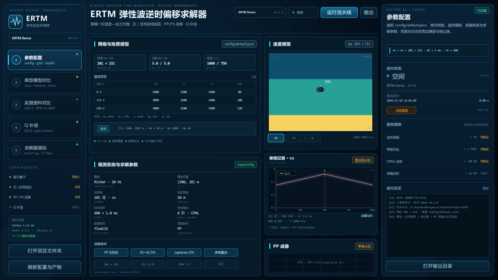

# ERTM 项目骨架

弹性波逆时偏移（ERTM）项目的首期工程骨架：统一配置、模型、求解器、成像、
数据、可视化、评价、异常与日志，以及一条可端到端运行的占位流水线。

> **当前阶段说明**：正演和成像是占位实现（直达波运动学 + 零场成像），
> 只用于验证工程链路，不可用于物理解释。真正的黏弹性正演、P/S 分离、
> PP/PS 成像和 Q 补偿在后续阶段实现。

## 1. 在 PyCharm 中运行

1. `File → Open` 选择 `C:\Users\30967\PycharmProjects\SeismicProjectERTM`。
2. 解释器选择项目内的 `.venv\Scripts\python.exe`。
3. 右键 `main.py` → `Run 'main'`。

如果 PyCharm 提示解释器无效，进入
`File → Settings → Project: SeismicProjectERTM → Python Interpreter`，
手动选择上面的 `.venv\Scripts\python.exe`。

## 2. 命令行运行

```powershell
# 完整占位流水线（默认 config/default.json）
.venv\Scripts\python.exe main.py

# 只做结构/接口自检
.venv\Scripts\python.exe main.py --check

# 自定义配置 / 输出目录 / 日志级别
.venv\Scripts\python.exe main.py --config config\default.json --output output --log-level INFO

# 运行结构测试
.venv\Scripts\python.exe -m unittest tests.test_structure -v
```

## 3. 目录结构

```text
SeismicProjectERTM/
├── main.py                     # 程序入口：参数解析、日志、调用流水线
├── config/
│   └── default.json            # 默认参数（网格、模型、源检、求解、成像、输出）
├── ertm/
│   ├── __init__.py             # 包初始化与公共导出
│   ├── config.py               # 配置 dataclass、加载、校验、保存快照
│   ├── types.py                # GridSpec / ElasticModel / ShotRecord / ImageResult 等数据契约
│   ├── interfaces.py           # ModelBuilder / ForwardSolver / Imager / DataStore 等 Protocol
│   ├── exceptions.py           # 统一异常体系
│   ├── logging_utils.py        # 统一日志初始化
│   ├── models.py               # 地质模型构建（层状 + 椭圆异常体占位）
│   ├── solver.py               # 正演/伴随接口与占位直达波记录
│   ├── imaging.py              # ERTM 成像接口与占位零场图像
│   ├── data.py                 # npz/JSON 读写、输出目录管理
│   ├── visualization.py        # 模型/炮集/图像/指标图
│   ├── evaluation.py           # 基础统计指标与图像对比
│   ├── pipeline.py             # 模块编排、产物清单、运行报告
│   └── diagnostics.py          # 结构自检与微型契约检查
├── tests/
│   ├── __init__.py
│   └── test_structure.py       # 结构/契约/读写/流水线测试
├── output/                     # 运行产物（自动创建）
│   ├── logs/
│   ├── models/
│   ├── shots/
│   ├── images/
│   └── reports/
├── data/                       # 实际数据（SEG-Y 等，后续使用）
├── docs/                       # 需求与技术文档
├── scripts/                    # 辅助脚本
├── requirements.txt
└── .venv/                      # 虚拟环境（勿手动改）
```

## 4. 模块职责

| 文件 | 职责 | 不做什么 |
|---|---|---|
| `main.py` | 命令行入口、日志初始化、异常兜底、打印摘要 | 不实现数值算法 |
| `ertm/config.py` | 读取/校验/保存 JSON 配置 | 不构建模型 |
| `ertm/types.py` | 跨模块数据契约 | 不含业务逻辑 |
| `ertm/interfaces.py` | 统一 Protocol 接口 | 不含实现 |
| `ertm/models.py` | 层状背景 + 异常体占位模型 | 不做 Q 拟合、各向异性 |
| `ertm/solver.py` | 正演/伴随接口与占位记录 | 不做波动方程延拓 |
| `ertm/imaging.py` | 成像接口与占位图像 | 不做反传/Q 补偿 |
| `ertm/data.py` | npz/JSON 持久化、目录管理 | 不解析 SEG-Y（后续） |
| `ertm/visualization.py` | 静态图输出 | 不做计算 |
| `ertm/evaluation.py` | 基础统计/误差指标 | 不做成像质量解释 |
| `ertm/pipeline.py` | 组装模块、生成产物和报告 | 不重复实现各模块逻辑 |
| `ertm/diagnostics.py` | 结构/接口自检 | 不做精度评价 |

## 5. 输出产物

一次完整运行会在 `output/` 下生成：

```text
output/
├── logs/ertm.log
├── models/model.npz
├── shots/shot.npz
├── images/model.png
├── images/shot.png
├── images/image_pp.png
├── images/image_pp.npz
├── images/metrics.png
└── reports/
    ├── config_snapshot.json
    ├── metrics.json
    └── run_report.json
```

`run_report.json` 包含配置、环境、模型统计、炮记录/图像元数据、指标、产物路径和耗时，
可用于复现和排查。

## 6. 配置说明

`config/default.json` 的主要字段：

| 段 | 关键字段 | 说明 |
|---|---|---|
| `grid` | `nx, nz, dx, dz` | 二维规则网格，数组形状 `(nz, nx)` |
| `model` | `layers, anomaly` | 层状背景 + 一个异常体（cave/fracture/fault） |
| `source` | `x, z, f0, kind` | 震源位置、主频、子波类型 |
| `receivers` | `count, x_start, x_end, z` | 检波点线 |
| `solver` | `nt, dt, order, boundary` | 时间步、阶数、边界类型 |
| `imaging` | `mode, normalize, laplacian` | 成像模式与后处理开关 |
| `output` | `root, save_figures, save_data` | 输出目录与开关 |
| `logging` | `level, file_name` | 日志级别与文件名 |

## 7. 测试

```powershell
# 结构 + 契约 + 读写 + 微型流水线
.venv\Scripts\python.exe -m unittest tests.test_structure -v

# 或者直接运行测试文件
.venv\Scripts\python.exe tests\test_structure.py

# 入口自检
.venv\Scripts\python.exe main.py --check
```

测试不验证数值精度，只验证模块能组装、数据形状一致、读写往返正确。

## 8. 依赖

以 `requirements.txt` 为准。首期骨架实际使用 NumPy 和 Matplotlib；
SciPy、Numba、PyVista、Segyio、Pandas 为后续数值计算/三维/SEG-Y 预留。

## 9. Qt 求解器工作台（workbench）

仓库中的 `workbench/` 是基于 PySide6 / Qt Quick 的 ERTM 可视化工作台：读取根目录的
配置、模型、单炮记录、成像产物和源码，并可直接调用 `main.py` 运行流水线。界面按
“参数配置 → 典型模型成像对比 → 实测资料对比 → Q 补偿 → 求解器源码”组织，
算法仍处于占位阶段时会明确标注“占位 / 待接入”。



“单炮记录”卡片展示时间 × 检波点的记录形式，点击可展开采集参数、直达波公式以及
RTM 中检波点波场的用途说明。

安装与运行方式见 [workbench/README.md](workbench/README.md)。
