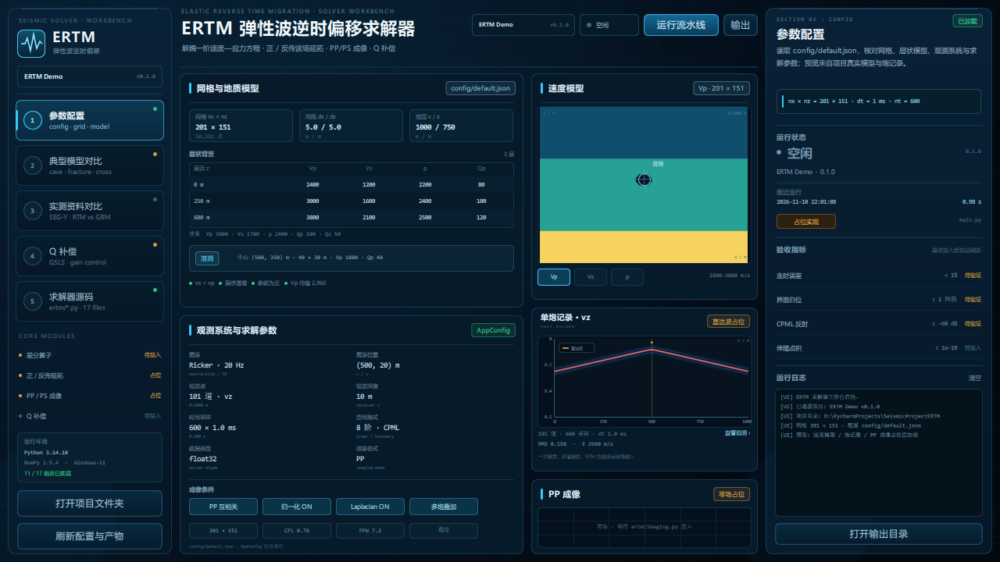
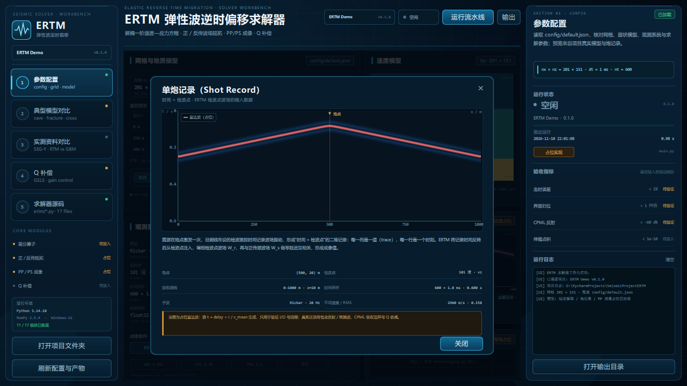
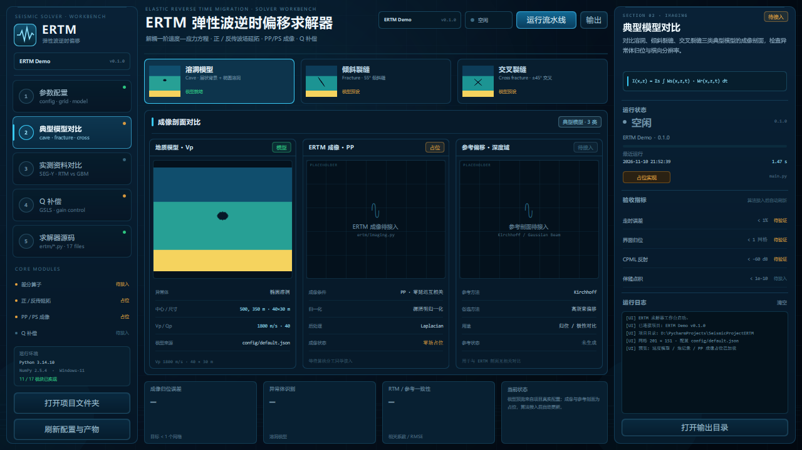

# ERTM 弹性波逆时偏移求解器 · Qt 工作台

`Challenge-Cup` 仓库的 Qt Quick 可视化工作台。界面读取仓库根目录下 ERTM 项目的真实配置、
模型、单炮记录、成像产物和源码，并通过 ERTM 虚拟环境直接运行 `main.py` 流水线。

> 板块按交付要求组织：**参数配置表 / 求解器源码 → 典型模型成像对比 →
> RTM / Kirchhoff / 高斯束实测资料对比 → Q 补偿与稳定性检查**。
> 算法核心仍由算法分工同学编写，界面用“占位 / 待接入”明确标识，不伪造物理结果。

## 1. 仓库中的位置

```text
Challenge-Cup/
├── main.py                  # ERTM 算法入口（根目录）
├── config/default.json
├── ertm/                    # 配置、模型、正演、成像、流水线
├── docs/
├── output/                  # 运行产物（被 .gitignore 忽略）
└── workbench/               # 本 Qt 工作台
    ├── main.py
    ├── ertm_bridge.py
    ├── requirements.txt
    ├── screenshots/
    └── untitled/            # Qt Quick 界面
```

工作台会自动把**上一级仓库根目录**识别为 ERTM 项目根目录，因此不需要额外设置路径。
如果单独复制 `workbench/` 到别处，请设置：

```powershell
$env:ERTM_PROJECT_ROOT = "D:\PycharmProjects\SeismicProjectERTM"
```

## 2. 运行

推荐在仓库根目录建一个虚拟环境，让“界面进程”和“ERTM 流水线”共用同一个 Python：

```powershell
cd Challenge-Cup
python -m venv .venv
.\.venv\Scripts\python.exe -m pip install -r requirements.txt
.\.venv\Scripts\python.exe -m pip install -r workbench\requirements.txt
.\.venv\Scripts\python.exe workbench\main.py
```

如果只想快速启动界面，最小依赖是：

```powershell
.\.venv\Scripts\python.exe -m pip install PySide6 numpy matplotlib
.\.venv\Scripts\python.exe workbench\main.py
```

PyCharm 中打开仓库根目录，解释器选根目录 `.venv\Scripts\python.exe`，运行
`workbench/main.py` 即可。界面默认 1280×720。

## 3. 界面板块

| 板块 | 内容 | 数据来源 |
|---|---|---|
| 参数配置 | 网格、层状背景、异常体、震源、检波点、时间/空间格式、成像条件 | `config/default.json` |
| 速度模型 / 单炮记录 / 成像 | 深色 Vp/Vs/ρ 预览、单炮记录（当前为占位直达波）、PP 零场占位 | `output/models/model.npz`、`output/shots/shot.npz`、`output/images/image_pp.npz` |
| 典型模型对比 | 溶洞、倾斜裂缝、交叉裂缝；模型 / ERTM / 参考偏移三栏 | 配置 + UI 模型预设（示意图，已标注） |
| 实测资料对比 | RTM / Kirchhoff / 高斯束 / 差异 QC 四象限 | `data/`（当前未导入 SEG-Y，界面为占位态） |
| Q 补偿 | Qp/Qs、GSLS、Gmax、αc、低通、增益曲线、点积/稳定性检查 | 配置 + 界面预设 |
| 求解器源码 | `ertm/*.py` 模块职责、行数、实现/占位/待建状态 | 仓库源码目录 |
| 运行 | 调用 `main.py`，实时回传日志并刷新产物 | `QProcess` |

参数配置表为只读展示，直接读取 `config/default.json`；修改配置后按 `Ctrl+R` 或点击
“刷新配置与产物”重新加载。

### 单炮记录（Shot Record）

震源在炮点激发一次，沿测线布设的 101 个检波器按时间记录波场振动，形成
“时间 × 检波点”的二维记录 `(nt, nrec) = (600, 101)`：每一列是一道（trace），
每一行是一个时刻。界面横轴为检波点 `x / m`（0–1000 m），纵轴为时间 `t / s`
（0–0.6 s，向下增大），橙色三角标记炮点位置（x=500 m）。

ERTM 会把这条记录时间反转后从检波点注入，得到检波点波场 `W_r`，再与正传源波场
`W_s` 做零延迟互相关，形成成像值。当前 `PlaceholderForwardSolver` 只按
`t = delay + r / v_mean` 生成直达波，因此界面标注为“直达波占位”，它用于验证
I/O 与流程，不是最终的弹性波场记录；点击卡片可查看完整采集参数与说明。







## 4. 与 ERTM 代码的对接

`ertm_bridge.py` 负责：

- 读取根目录 `config/default.json`、`output/reports/*.json`；
- 用 NumPy 读取 `model.npz` / `shot.npz` / `image_pp.npz`，渲染成深色界面预览；
- 枚举根目录 `ertm/*.py` 并读取源码供代码面板展示；
- 通过 `QProcess` 调用：

  ```text
  <repo>\.venv\Scripts\python.exe main.py --config config/default.json --log-level INFO
  ```

- 运行结束后自动重读产物，刷新模型、单炮记录和日志。

界面上的“运行流水线 / F5”会真实运行当前仓库的占位流水线（约 1–2 秒），
并更新根目录 `output/` 下的产物。`output/` 默认被 `.gitignore` 忽略，不把运行结果
误提交进仓库。

## 5. 当前状态说明

- `ertm/solver.py`、`ertm/imaging.py` 仍是占位实现；界面显示“占位实现 / 零场占位”，
  不会把占位结果显示成物理成像。
- “倾斜裂缝 / 交叉裂缝”的模型预览是界面根据层状配置生成的**示意图**，用于版式与
  对比流程；算法侧的正式模型与成像接入后，替换 `ertm_bridge.py` 的预览来源即可。
- 实测资料尚未导入，`data/` 目录为空；界面保留 SEG-Y 接入入口与四象限对比版式。
- 验收指标当前显示“待验证 / 待接入”，算法接入并通过测试后由数据侧更新。

## 6. 快捷键

| 快捷键 | 功能 |
|---|---|
| `F5` | 运行 ERTM 流水线 |
| `Ctrl+R` | 重新读取配置与产物 |

## 7. 目录说明

```text
workbench/
├── main.py                  # Qt 应用入口，注入 bridge
├── ertm_bridge.py           # 配置/产物/源码/进程桥接
├── requirements.txt         # PySide6 + NumPy
├── screenshots/             # 界面截图
└── untitled/
    ├── Main.qml             # 窗口、标题栏、五段式工作流
    ├── components/          # 侧栏、右栏、图窗、按钮等
    ├── views/               # 参数配置、模型对比、实测对比、Q 补偿、源码
    └── theme/Theme.js
```

## 8. 依赖

- PySide6 6.12
- NumPy 2.5
- ERTM 项目自身依赖：NumPy / Matplotlib（运行流水线时使用根目录 `.venv`）
